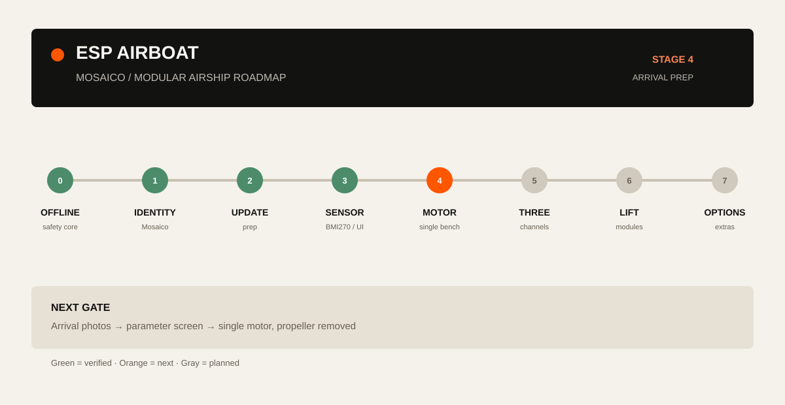

# ESP Airship based on Mosaico

[中文](README.zh-CN.md) · **English**

A modular helium airship built around ESP-Mosaico. This repository contains the AirBoat safety baseline, hardware notes for a DRV8833 motor stage, a reproducible Mosaico workspace bootstrap, and a staged path from a safe bench test to a modular balloon platform.

[Open the interactive roadmap](https://404-not-found-error.github.io/ESP-Airship-based-on-Mosaico/roadmap.html) · 

## What is here

- `firmware/airboat_baseline/` — portable ESP-Mosaico application source. The current release is a software-only safety baseline: display, touch, BMI270 snapshots, command queue, and a latched motor safety state machine. GPIO/PWM is deliberately added in the next stage.
- `docs/roadmap.html` — an offline, interactive project map. It shows the current verified baseline, the next four build cards, the control chain, and the modular balloon concept.
- `docs/architecture.md` — ownership, data flow, update boundary, and the planned DRV8833 adapter.
- `docs/pipeline.md` — stage gates and acceptance evidence.
- `docs/design-system.md` — the shared Mosaico-inspired visual and interaction rules.
- `hardware/drv8833/` — wiring notes, an arrival record template, and a single-motor bench checklist.
- `scripts/` — workspace bootstrap, host checks, and the arrival-parameter screen.

The original AirPuff project remains the reference for the airship concept and parts: [esp-friends/esp-airpuff](https://gitee.com/esp-friends/esp-airpuff). The upstream Mosaico framework is fetched at a pinned commit by the bootstrap script instead of being copied into this repository.

## Current state

| Area | State |
| --- | --- |
| Mosaico display and touch | Verified on the ESP-Mosaico target |
| ARM / E-STOP / CLEAR state machine | Verified in host tests and on-device UI |
| BMI270 lifecycle and pose capture | Verified baseline; software recovery passed, electrical I²C fault recovery remains to test |
| DRV8833 physical output | Stage 4; ordered hardware is awaiting arrival and parameter checks |
| Modular balloon lift and barometer | Design stage; measure each module before flight |

“Verified” means the evidence in the development records passed. “Next” and “Design” are plans; they do not claim a flight result.

## Quick start

The supported workflow keeps this repository as the application source and uses a separate Mosaico checkout for the SDK, BSP, and product tools.

On Windows, install **PowerShell 7**, **Python 3.10+**, and **Git 2.28+**. The portable checks use **Zig 0.14.1**, installed below into the ignored local tools directory.

```powershell
git clone https://github.com/404-NOT-FOUND-ERROR/ESP-Airship-based-on-Mosaico.git
cd ESP-Airship-based-on-Mosaico
python -m pip install --target .tools/host-compiler ziglang==0.14.1
.\scripts\bootstrap-mosaico-workspace.ps1
.\scripts\run-host-checks.ps1
```

The bootstrap script clones `esp-mosaico/esp-mosaico-vibe` at the recorded revision and copies the application into `.mosaico-workspace/projects/airboat_baseline`. Host checks run on the PC. Firmware builds use ESP-IDF 6.2 at commit `7b9cc1ac79f865983f59bb8ff3ff43eb74ff1dbe` for `esp32s31`; follow the pinned workspace's setup guide when starting that stage.

Rerunning bootstrap reuses an identical application. For a changed copy, `-ForceSync` saves the previous directory in `.mosaico-workspace/.airboat-backups/` before importing the public source.

To preview the UI without hardware:

```powershell
.\scripts\run-mosaico-sim.ps1
```

The first hardware session follows the identity and update rules in [docs/architecture.md](docs/architecture.md). Do not select a device by an old COM number; use the live Mosaico discovery result and verify its identity before any update.

## Hardware path

The first powered experiment is one motor with its propeller removed. The ordered DRV8833 boards are the soldered-header version. The exact motor current, battery connector, driver package, and wire rating are recorded when the parcel arrives. Fill the JSON record and run:

```powershell
python scripts/check-arrival.py --record hardware/drv8833/arrival-record.template.json
```

The check only screens parameters. A separate bench acceptance is required before the driver is released to a three-motor build. The checklist explains the power cutoff, current limit, direction change dead time, E-STOP, timeout, temperature, and restart checks.

## Development path

1. Keep the software baseline stable and reproducible.
2. Add one `app_motor_drv8833` adapter behind the existing safety owner and pass a single-channel, propeller-off bench test.
3. Extend the same adapter to three channels and verify power, default state, timeout, E-STOP, and restart.
4. Build the balloon frame from independent modules. Measure lift and mass module by module; then balance the complete suspended assembly.
5. Add a BMP581 as an ambient barometer in the gondola for relative altitude trend. Treat balloon pressure/leak sensing as a separate design.
6. Add camera, remote control, and closed-loop flight only after the tethered low-speed gate is complete.

The [interactive roadmap](https://404-not-found-error.github.io/ESP-Airship-based-on-Mosaico/roadmap.html) shows the current stage and what to do when the package arrives. The source is [docs/roadmap.html](docs/roadmap.html).

## References

- [ESP-Mosaico documentation](https://documentation.espressif.com/esp-dev-kits/zh_CN/latest/esp32s31/esp-mosaico/index.html)
- [Mosaico developer guide](https://mosaico.ai/zh-hans/guide)
- [ESP-Airship / OSHWHub](https://oshwhub.com/esp-college/esp-airship)
- [ESP-AirPuff reference project](https://gitee.com/esp-friends/esp-airpuff)

## License

The original application and documentation in this repository are released under the MIT License. Upstream Mosaico components and third-party assets keep their own licenses; see the linked upstream repositories before redistribution.
