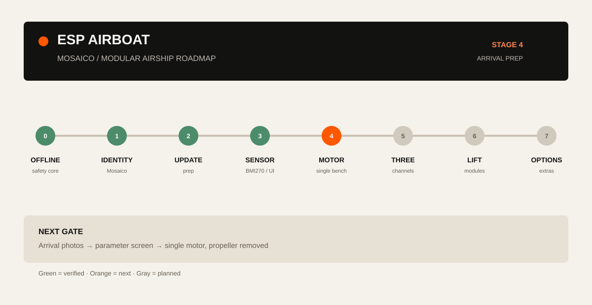

# 基于 Mosaico 的模块化氦气飞艇

**中文** · [English](README.md)

这个仓库把 ESP-Mosaico 变成一个可逐步复刻的飞艇控制平台：先完成安全软件基线，再接一台无桨电机，之后扩展三路动力，最后用多个独立氦气球组成模块化浮力结构。



## 仓库内容

- `firmware/airboat_baseline/`：可移植的 ESP-Mosaico 应用源码。当前版本是软件安全基线，包含显示、触摸、BMI270 快照、命令队列和锁存式电机安全状态机；GPIO/PWM 会在下一阶段接入。
- `docs/roadmap.html`：离线交互路线页，展示已验收基线、接下来四张操作卡、控制链路和模块化气囊结构。
- `docs/architecture.md`：模块职责、数据流、固件更新边界和 DRV8833 适配位置。
- `docs/pipeline.md`：阶段入口、完成条件和证据口径。
- `docs/design-system.md`：Mosaico 风格的视觉和交互约定。
- `hardware/drv8833/`：接线说明、到货参数模板和单电机台架单。
- `scripts/`：Mosaico 工作区引导、主机检查和到货参数筛查工具。

飞艇概念和材料参考 [esp-friends/esp-airpuff](https://gitee.com/esp-friends/esp-airpuff)。Mosaico 框架由引导脚本按固定提交获取，不复制进本仓库。

## 当前状态

| 项目 | 状态 |
| --- | --- |
| Mosaico 显示与触摸 | 已在目标设备验收 |
| ARM / E-STOP / CLEAR 状态机 | 主机测试和设备界面均已验收 |
| BMI270 生命周期与姿态采集 | 基线已验收；装艇方向需要重新标定 |
| DRV8833 实际电机输出 | 下一阶段；以到货参数和单路台架为入口 |
| 模块化气囊与气压计 | 设计阶段；先分别称重和测净升力 |

“已验收”只表示已有记录通过；“下一阶段”和“设计阶段”是计划，不代表已经飞行。

## 快速开始

本项目把应用源码与 Mosaico SDK、BSP、产品工具分开保存：

Windows 先准备 **PowerShell 7**、**Python 3.10+** 和 **Git 2.28+**。电脑端测试使用 **Zig 0.14.1**，下面的命令会把它安装到已忽略的本地工具目录。

```powershell
git clone https://github.com/404-NOT-FOUND-ERROR/ESP-Airship-based-on-Mosaico.git
cd ESP-Airship-based-on-Mosaico
python -m pip install --target .tools/host-compiler ziglang==0.14.1
.\scripts\bootstrap-mosaico-workspace.ps1
.\scripts\run-host-checks.ps1
```

引导脚本会按记录版本克隆 `esp-mosaico/esp-mosaico-vibe`，并把应用复制到 `.mosaico-workspace/projects/airboat_baseline`。主机检查在电脑上完成。固件构建使用 ESP-IDF 6.2 的 `7b9cc1ac79f865983f59bb8ff3ff43eb74ff1dbe` 提交，目标为 `esp32s31`；进入该阶段时按固定版本工作区的说明准备环境。

重复运行会复用相同源码。已有目录内容变化时，使用 `-ForceSync`，脚本会先把原目录完整保存到 `.mosaico-workspace/.airboat-backups/`，再同步公开源码。

无硬件预览界面：

```powershell
.\scripts\run-mosaico-sim.ps1
```

第一次连接设备时，按 [架构说明](docs/architecture.md) 做身份和更新核对。不要把历史 COM 端口当作设备身份；使用当前发现结果并确认设备身份后再更新。

## 硬件路线

第一步动力实验只接一台电机，桨叶必须拆下。已采购的是焊好排针的 DRV8833 模块。包裹到达后记录电机电流、电池插头、驱动芯片封装和线束能力：

```powershell
python scripts/check-arrival.py --record hardware/drv8833/arrival-record.template.json
```

参数筛查通过不等于动力放行。还要按台架单完成限流、电流、换向间隔、急停、超时、温升和重启检查，再进入三路控制。

## 开发路线

1. 固定软件基线，保持主机测试和模拟器可复现。
2. 在现有安全所有者之后增加 `app_motor_drv8833`，先通过单路、拆桨台架。
3. 扩展三路，验证电源、默认态、超时、急停和重启。
4. 用独立气囊搭建承力框架，逐囊测净升力和质量，再测完整悬挂体配平。
5. 在吊舱通风位置增加 BMP581，提供环境气压和相对高度趋势；囊内压力/漏气检测单独设计。
6. 台架和系留低速测试通过后，再加入摄像头、遥控和闭环飞行。

可视化路线见 [docs/roadmap.html](docs/roadmap.html)。

## 参考资料

- [ESP-Mosaico 文档](https://documentation.espressif.com/esp-dev-kits/zh_CN/latest/esp32s31/esp-mosaico/index.html)
- [Mosaico 开发指南](https://mosaico.ai/zh-hans/guide)
- [ESP-Airship / 立创开源硬件](https://oshwhub.com/esp-college/esp-airship)
- [ESP-AirPuff 参考项目](https://gitee.com/esp-friends/esp-airpuff)

## 许可证

本仓库自有应用和文档使用 MIT License。Mosaico 上游组件和第三方素材保留各自许可证；再分发前请查看对应上游仓库。
